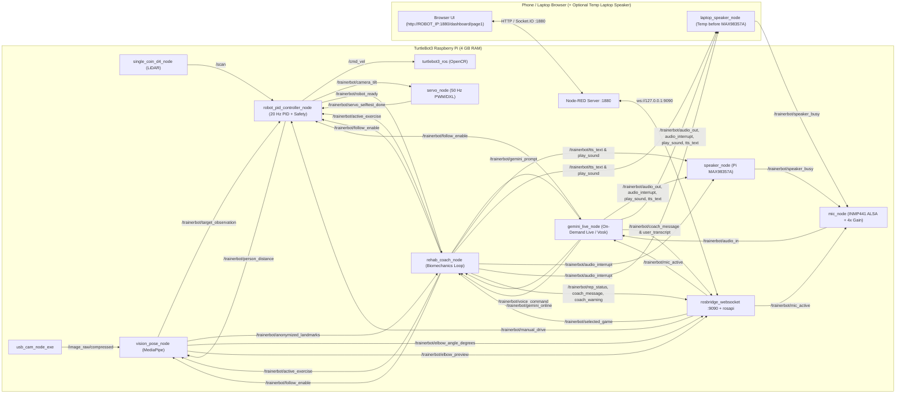

# WTrainer — Standalone Rehabilitation TurtleBot3 (All-on-Bot + Node-RED)

**WTrainer** (`trainerbot_rehab`) is a standalone, safety-first ROS 2 Jazzy rehabilitation personal trainer running completely on a **4 GB Raspberry Pi** inside a TurtleBot3 Burger. It assists wheelchair users and individuals with lower-limb hemiplegia using **biomechanical anti-cheat posture feedback**, bidirectional LiDAR + camera-first framing, a smooth Y-axis Safety Grid gimbal, and dual **on-demand Gemini 3.8 Live / offline Vosk** voice control — operated from any phone or laptop browser via **Pi-hosted Node-RED Dashboard 2.0**.

---

## 1. Robot + Browser Architecture (All-on-Bot)

Because a 4 GB Raspberry Pi leaves ~3 GB of headroom after hardware bringup, **all ROS 2 compute, MediaPipe perception, biomechanical coaching, AI/offline voice, and Node-RED live on the robot** — eliminating Wi-Fi video/DDS lag between devices:

| Device | Role | Running Components |
| :--- | :--- | :--- |
| **TurtleBot3 Raspberry Pi** *(4 GB RAM)* | Complete autonomous brain, hardware I/O & UI server | `robot.launch.py`, `usb_cam_node_exe`, `robot_pid_controller_node`, `servo_node`, `mic_node`, `speaker_node` (or temporary Laptop speaker bridge), `vision_pose_node` (MediaPipe), `rehab_coach_node` (biomechanics loop), `gemini_live_node` (Gemini 3.8 Live / Offline Vosk), `rosbridge_websocket`, `rosapi_node`, native **Node-RED Dashboard 2.0** |
| **Phone / Laptop Browser** | Patient / therapist dashboard | Any browser → `http://<ROBOT_IP>:1880/dashboard/page1` (Drag-and-drop editor: `http://<ROBOT_IP>:1880`) |

> **Privacy Guarantee:** Only anonymized numeric MediaPipe joint angles, upper-arm flare, shoulder shrug ratio, and spine lean are forwarded to Gemini — **never** raw video frames, images, or personal identifiers.

> **Legacy Split Mode Preserved:** The original Laptop+Pi split launch (`launch/laptop_brain.launch.py` + `scripts/start_system.sh`) and `trainerbot_rehab/laptop/` module paths are kept intact for reference or fallback (`bash scripts/start_bot_standalone.sh <ROBOT_IP> laptop-vision`).

---

## 2. Physical Wiring (Raspberry Pi 40-Pin Header)

Hold the Raspberry Pi with the **USB/Ethernet ports pointing DOWN**. **Pin 1** is top-left; odd pins are on the left column, even pins are on the right column.

| Component | Module Pin | Pi Physical Pin | BCM / Interface | Notes |
| :--- | :--- | :--- | :--- | :--- |
| **INMP441 Mic** | `VDD` | Pin 1 | `3.3V` | **3.3V only** (never 5V) |
| **INMP441 Mic** | `GND` | Pin 6 | `GND` | Common ground |
| **INMP441 Mic** | `L/R` | Pin 9 | `GND` | Selects Left channel |
| **INMP441 Mic** | `SCK` | Pin 12 | `GPIO 18` | Shared I2S Bit Clock |
| **INMP441 Mic** | `WS` | Pin 35 | `GPIO 19` | Shared I2S Frame Clock |
| **INMP441 Mic** | `SD` | Pin 38 | `GPIO 20` | I2S Data In |
| **Camera PWM Servo** *(or Dynamixel via USB/OpenCR)* | Signal | Pin 32 | `GPIO 12` | Hardware PWM0 (`VCC` → `5V`, `GND` → shared Pi `GND`) |
| **MAX98357A Amp** *(with APKLVSR 3W 4Ω Speaker)* | `VIN` / `GND` | Pin 2 (`5V`) / Pin 6 (`GND`) | `5V` / `GND` | Connects 2-wire 4 Ω speaker `+`/`-` safely |
| **MAX98357A Amp** | `BCLK` / `LRC` / `DIN` | Pin 12 / Pin 35 / Pin 40 | `GPIO 18` / `19` / `21` | Shares I2S clocks with INMP441 |

> **Speaker Note:** We can't wire the bare 4 Ω 3 W speaker straight to the Pi's unamplified 3.5 mm jack. Until your MAX98357A arrives [`start_bot_standalone.sh`](scripts/start_bot_standalone.sh) automatically borrows the Laptop's speakers via `laptop_speaker_node`. Once the MAX98357A is connected on the Pi, we pass `pi-speaker`.

---

## 3. One-Time Installation (4 GB TurtleBot3 Pi)

SSH into your Pi (`ssh ubuntu@<ROBOT_IP>`):

```bash
# 1. Clone into your ROS 2 workspace
mkdir -p ~/turtlebot3_ws/src
cd ~/turtlebot3_ws/src
git clone https://github.com/SantiagoMartinezHernandez/WTrainer.git trainerbot_rehab

# 2. Install ROS 2 Jazzy bridge/camera, audio tools, and Python packages
sudo apt update
sudo apt install -y \
  ros-jazzy-rosbridge-server ros-jazzy-rosapi ros-jazzy-usb-cam \
  alsa-utils ffmpeg espeak-ng \
  python3-pip python3-gpiozero python3-lgpio python3-rpi-lgpio \
  python3-numpy python3-opencv python3-dotenv python3-yaml
sudo usermod -aG audio,video,dialout,gpio $USER

cd ~/turtlebot3_ws/src/trainerbot_rehab
# Note: Raspberry Pi 4 (Cortex-A72) lacks ARMv8 AES; pin a non-AES MediaPipe build (e.g., 0.10.14) if newer PyPI wheels throw SIGILL.
python3 -m pip install --break-system-packages -r requirements_laptop.txt "numpy<2" vosk

# 3. Install Node.js 22 LTS (Ubuntu 24.04 ships Node 18, but Node-RED requires >= 22.9) & Node-RED
sudo apt remove -y nodejs npm
curl -fsSL https://deb.nodesource.com/setup_22.x | sudo -E bash -
sudo apt install -y nodejs
sudo npm install -g --unsafe-perm node-red
mkdir -p ~/.node-red && cd ~/.node-red
npm install @flowfuse/node-red-dashboard node-red-contrib-ros2-suite

# 4. Enable I2S audio in /boot/firmware/config.txt
sudo nano /boot/firmware/config.txt
# Uncomment / add:
#   dtparam=i2s=on
#   dtoverlay=googlevoicehat-soundcard

sudo reboot
```

After rebooting, build on the Pi and pre-cache offline voice/STT assets (while connected to internet):
```bash
ssh ubuntu@<ROBOT_IP>
cd ~/turtlebot3_ws
source /opt/ros/jazzy/setup.bash
colcon build --packages-select trainerbot_rehab
source install/setup.bash

# Optional: pre-cache Google UK MP3 clips + offline Vosk (~40 MB) for zero-Wi-Fi labs
python3 ~/turtlebot3_ws/src/trainerbot_rehab/scripts/precache_uk_voice.py --with-vosk

# Optional: verify servo sweep, camera, and INMP441 ALSA card (plughw:1,0)
bash ~/turtlebot3_ws/src/trainerbot_rehab/scripts/hardware_check.sh
```

For online Gemini 3.8 Live coaching, copy your private `.env` (`GEMINI_API_KEY=...`) onto the Pi (`.env` is gitignored):
```bash
# Run from Laptop:
scp ~/turtlebot3_ws/src/trainerbot_rehab/.env ubuntu@<ROBOT_IP>:~/turtlebot3_ws/src/trainerbot_rehab/.env
```

---

## 4. Running & Stopping Standalone Mode

Ensure passwordless SSH is set up once (`ssh-copy-id ubuntu@<ROBOT_IP>`).

### Start Everything (Robot + Node-RED on Pi)
```bash
cd ~/turtlebot3_ws/src/trainerbot_rehab

# Today (all compute on Pi, borrowing Laptop speaker until MAX98357A is wired):
bash scripts/start_bot_standalone.sh <ROBOT_IP>

# With MAX98357A speaker wired directly on Pi (100% standalone):
bash scripts/start_bot_standalone.sh <ROBOT_IP> pi-speaker

# Fallback if Pi CPU cannot run MediaPipe (runs vision_pose_node on Laptop):
bash scripts/start_bot_standalone.sh <ROBOT_IP> laptop-vision
```
Open **`http://<ROBOT_IP>:1880/dashboard/page1`** on your Laptop or Phone browser (and hard-refresh `Ctrl+Shift+R` after flow updates).

### Stop Everything Cleanly (Including LiDAR Motor)
Press `Ctrl+C` in the startup terminal, or run:
```bash
cd ~/turtlebot3_ws/src/trainerbot_rehab
bash scripts/stop_system.sh <ROBOT_IP>
```
`stop_system.sh` sends **`SIGINT` (1.5 s) → `SIGTERM` (1.0 s) → `SIGKILL`** to `single_coin_d4_node` / `ld08_driver` and all nodes so the LiDAR stops spinning cleanly.

### Check Live Pi RAM Headroom
```bash
bash ~/turtlebot3_ws/src/trainerbot_rehab/scripts/check_pi_memory.sh <ROBOT_IP>
```

---

## 5. System Explainability & Main Loop

1. **`servo_node` (50 Hz smooth gimbal):**
   - Sweeps `0° → +25° → -25° → 0°` on startup (`startup_selftest`), publishes `TRANSIENT_LOCAL` `/trainerbot/servo_selftest_done`, filters commands via EMA (`alpha=0.15`), slew-limits to `30°/s` (`1.0–2.0 ms` pulses), and detaches PWM after `0.35 s` idle to eliminate servo buzzing.
2. **`robot_pid_controller_node` (20 Hz real-time motion, LiDAR & Safety Grid):**
   - **`camera_reversed` (default `true`):** Aligns linear drive (`/cmd_vel`), `±10°` LiDAR target bearing, and front (`0.90 m`) / rear (`0.40 m`) safety cones when the camera faces the `-X` side of the TurtleBot3 (`0.25 m` bump guard for manual buttons; `< 0.14 m` self-hit filter).
   - **Y-Axis Safety Grid (`y_grid_min=0.32`..`0.68`, `0.8 s` cooldown):** Holds tilt idle while shoulders are inside `[0.32, 0.68]`, stepping smoothly (`±5°` max) only when the user leaves the grid.
   - **Bidirectional Camera-First Framing:** Backs away smoothly (`-0.05` to `-0.14 m/s`) whenever `person_distance < target_distance - 0.12 m` or `shoulder_width > 0.28`; rotates horizontally before approaching; holds distance in `[0.16..0.28]`; approaches up to `0.90 m` front safety when centered and far (`> 1.52 m`). Halts wheels if observations stop for `1.8 s`.
3. **`vision_pose_node` + Biomechanical Anti-Cheat Constraints (`joint_angles.py`, `rehab_coach_node.py`):**
   - Smooths focus joint angles with a **5-frame median filter** (`statistics.median`) and requires continuous **`violation_persist_s = 0.7 s`** before triggering a posture warning (preventing single-frame MediaPipe false positives).
   - Enforces exercise-specific biomechanics in [`config/exercise_catalog.json`](config/exercise_catalog.json):
     - **Left/Right Elbow Flexion:** upper-arm sideways flare `_angle_from_vertical_deg <= 35°`, scale-invariant shoulder shrug ratio `<= 0.20`, torso tilt `<= 18°`.
     - **Seated Shoulder Raise:** extended elbow `>= 125°` (prevents bent-elbow shortcuts), max safe elevation `<= 115°` (avoids impingement), torso tilt `<= 15°`.
     - **Seated Core Reach:** lateral spine lean `<= 25°`, torso tilt `<= 25°`.
4. **Resilient Dual-Mode Voice (`mic_node.py`, `gemini_live_node.py`, `speaker_node.py`):**
   - `mic_node` auto-detects the INMP441 (`plughw:1,0`), starts muted (`start_active=false`), applies `4.0x` software gain, and gates audio during `speaker_busy` (+ `0.15 s` holdoff).
   - `gemini_live_node` runs **on-demand** only while the AI slider is ON or a button prompt is active (`35 s` window), reconnects cleanly with exponential backoff (`2 s → 30 s`), caps retries at `6 / 5 min` (`60 s` cooldown on `429`/quota errors), prioritizes spoken **`STOP_WORDS`** (`stop`, `halt`, `pause`, etc.), wakes on fuzzy **`"turtle"`** matches + chime, and falls back to **Offline Vosk** with live partial transcripts (`... <words>`) when offline or cooled down.
   - `speaker_node` caches Google UK `gTTS` MP3s in `~/.cache/trainerbot_tts` for offline playback and serializes TTS + Gemini PCM with `_speech_lock` so two voices never collide.

### Main Loop Architecture & Data Flow



### Complete ROS 2 Topic Pub/Sub Map

| Topic | Type | Publisher(s) | Subscriber(s) | Purpose |
| :--- | :--- | :--- | :--- | :--- |
| `/image_raw/compressed` | `sensor_msgs/msg/CompressedImage` | `usb_cam_node_exe` | `vision_pose_node` | `640x480 @ 15 Hz` JPEG stream (`RELIABLE`, `depth=1`) |
| `/scan` | `sensor_msgs/msg/LaserScan` | `single_coin_d4_node` | `robot_pid_controller_node` | `±10°` foreground distance + safety stops |
| `/cmd_vel` | `geometry_msgs/msg/TwistStamped` | `robot_pid_controller_node` | `turtlebot3_ros` | Wheel velocity commands (negated if `camera_reversed:=true`) |
| `/trainerbot/target_observation` | `std_msgs/msg/String` (JSON) | `vision_pose_node` | `robot_pid_controller_node` | `{detected, mid_x, mid_y, shoulder_width}` for Pi PID & Safety Grid |
| `/trainerbot/camera_tilt` | `std_msgs/msg/Float32` | `robot_pid_controller_node` | `servo_node`, `vision_pose_node` | Y-axis camera tilt (`[0.32..0.68]` Safety Grid) |
| `/trainerbot/servo_selftest_done` | `std_msgs/msg/Bool` | `servo_node` | `robot_pid_controller_node` | `TRANSIENT_LOCAL` completion after `0° → +25° → -25° → 0°` sweep |
| `/trainerbot/robot_ready` | `std_msgs/msg/Bool` | `robot_pid_controller_node` | `rehab_coach_node` | Triggers victory chime once Pi servo self-test completes |
| `/trainerbot/person_distance` | `std_msgs/msg/Float32` | `robot_pid_controller_node` | `vision_pose_node` | Filtered foreground LiDAR distance (m) shown on HUD |
| `/trainerbot/user_detected` | `std_msgs/msg/Bool` | `robot_pid_controller_node` | Diagnostics / echo | Reports whether MediaPipe detects a user |
| `/trainerbot/follow_enable` | `std_msgs/msg/Bool` | `rehab_coach_node`, `gemini_live_node` | `robot_pid_controller_node`, `vision_pose_node` | Starts/pauses wheel + tilt framing (`False` immediately on mic stop) |
| `/trainerbot/active_exercise` | `std_msgs/msg/String` (JSON) | `rehab_coach_node` | `vision_pose_node`, `robot_pid_controller_node` | Sends `focus_joints`, `framing_distance_m`, and `framing_tilt_offset_deg` |
| `/trainerbot/anonymized_landmarks` | `std_msgs/msg/String` (JSON) | `vision_pose_node` | `rehab_coach_node`, `gemini_live_node` | Anonymized joint angles, flare, shrug ratio & spine lean |
| `/trainerbot/selected_game` | `std_msgs/msg/String` | Node-RED (`rosbridge`) | `rehab_coach_node` | Dashboard exercise buttons, PID toggle, AI buttons, and Stop |
| `/trainerbot/load_exercise` | `std_msgs/msg/String` (JSON) | External/UI JSON | `rehab_coach_node` | Loads a custom exercise definition dynamically |
| `/trainerbot/manual_drive` | `geometry_msgs/msg/Twist` | Node-RED (`rosbridge`) | `robot_pid_controller_node` | `0.6 s` D-pad manual drive steps (`0.25 m` bump guard) |
| `/trainerbot/elbow_angle_degrees` | `std_msgs/msg/Float32` | `vision_pose_node` | Node-RED (`rosbridge`) | 2-decimal active joint angle for the dashboard gauge |
| `/trainerbot/elbow_preview` | `std_msgs/msg/String` (JSON) | `vision_pose_node` | Node-RED (`rosbridge`) | Base64 JPEG HUD preview with Safety Grid & skeleton overlay |
| `/trainerbot/rep_status` | `std_msgs/msg/String` | `rehab_coach_node` | Node-RED (`rosbridge`) | Rep progress counter (e.g. `2 / 5 reps`) |
| `/trainerbot/coach_warning` | `std_msgs/msg/String` | `rehab_coach_node` | Node-RED (`rosbridge`) | Biomechanical form & pace warnings |
| `/trainerbot/coach_message` | `std_msgs/msg/String` | `rehab_coach_node`, `gemini_live_node` | Node-RED (`rosbridge`) | Spoken/written coaching cues in the UI |
| `/trainerbot/gemini_online` | `std_msgs/msg/Bool` | `gemini_live_node` | `rehab_coach_node` | `TRANSIENT_LOCAL` status toggling online Gemini vs offline UK cues |
| `/trainerbot/mic_active` | `std_msgs/msg/Bool` | Node-RED (`rosbridge`) | `mic_node`, `gemini_live_node` | Mutes/unmutes Pi mic and gates on-demand Gemini WebSocket |
| `/trainerbot/audio_in` | `std_msgs/msg/UInt8MultiArray` | `mic_node` | `gemini_live_node` | 16 kHz mono PCM mic chunks (`4.0x` software gain, echo-gated) |
| `/trainerbot/user_transcript` | `std_msgs/msg/String` | `gemini_live_node` | Node-RED (`rosbridge`) | Live speech transcript & Vosk partials in `Heard (Mic Debug)` |
| `/trainerbot/voice_command` | `std_msgs/msg/String` | `gemini_live_node` | `rehab_coach_node` | Spoken commands (`stop`, `start`, `more_details`, `suggest_routine`, exercise IDs) |
| `/trainerbot/gemini_prompt` | `std_msgs/msg/String` | `rehab_coach_node` | `gemini_live_node` | Button-triggered prompts (attaches cached anonymized telemetry) |
| `/trainerbot/audio_out` | `std_msgs/msg/UInt8MultiArray` | `gemini_live_node` | `speaker_node` | 24 kHz mono PCM speech from Gemini Live |
| `/trainerbot/tts_text` | `std_msgs/msg/String` | `rehab_coach_node`, `gemini_live_node` | `speaker_node` | Cached/online Google UK `gTTS` cue (`espeak-ng` fallback) |
| `/trainerbot/play_sound` | `std_msgs/msg/String` | `rehab_coach_node`, `gemini_live_node` | `speaker_node` | Chimes (`victory`, `rep_complete`, `wake`, `warning`, `stop`) |
| `/trainerbot/audio_interrupt` | `std_msgs/msg/Bool` | `gemini_live_node`, `rehab_coach_node` | `speaker_node` | Immediately halts active PCM speech on interruption or Stop |
| `/trainerbot/speaker_busy` | `std_msgs/msg/Bool` | `speaker_node` | `mic_node` | Half-duplex echo gate (+ `0.15 s` holdoff after playback) |

---

## 6. Editing Node-RED Visually & Switching Labs/Wi-Fi

### Drag-and-Drop Node-RED Editing
1. While `start_bot_standalone.sh` is running, open the visual flow editor at **`http://<ROBOT_IP>:1880`** (dashboard is **`http://<ROBOT_IP>:1880/dashboard/page1`**).
2. Drag, edit, and **Deploy**, then save the Pi's deployed flow back into Git:
   ```bash
   cp ~/.node-red/flows.json ~/turtlebot3_ws/src/trainerbot_rehab/node_red/flows.json
   ```

### Switching Between Home Wi-Fi and Lab Wi-Fi (`/etc/netplan`)
- Changing `/etc/netplan/*.yaml` on the Pi only changes its Wi-Fi SSID and IP (`192.168.1.10` at home vs `192.168.1.108` at ProFab).
- **No ROS 2 code or `flows.json` hardcodes the Pi IP.** Simply pass the new IP:
  ```bash
  bash scripts/start_bot_standalone.sh <NEW_LAB_ROBOT_IP>
  ```

---

## 7. Additional Documentation
- Detailed wiring diagrams & troubleshooting: [`docs/WIRING_AND_SETUP.md`](docs/WIRING_AND_SETUP.md)
- Exercise catalog: [`config/exercise_catalog.json`](config/exercise_catalog.json)
