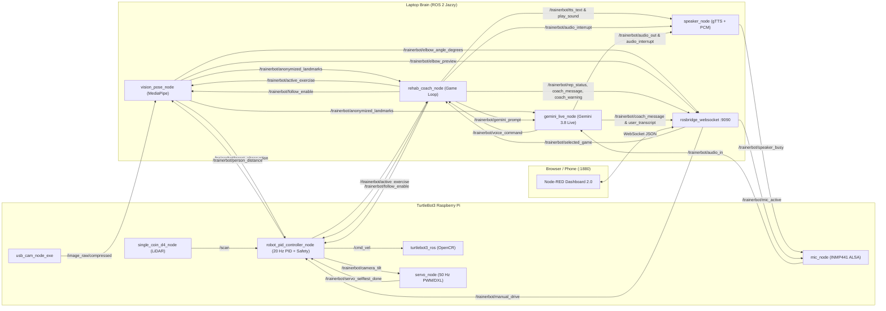

# WTrainer — Universal Human-Framing Rehabilitation TurtleBot3

**WTrainer** (`trainerbot_rehab`) is a safety-first, 3-device ROS 2 Jazzy rehabilitation personal trainer built on the TurtleBot3 Burger. It helps wheelchair users and individuals with lower-limb hemiplegia train upper-body and core muscles with live posture feedback, smooth automated camera framing, and wake-word-gated voice coaching via **Gemini 3.8 Live (`gemini-3.8-live`)**.

---

## 1. 3-Device Architecture

| Device | Role | ROS 2 Nodes & Services |
| :--- | :--- | :--- |
| **TurtleBot3 Raspberry Pi** *(1 GB RAM)* | Hardware I/O, local LiDAR safety & PID/grid motion | `robot.launch.py`, `usb_cam_node_exe`, `robot_pid_controller_node` (20 Hz PID + 1.8 s watchdog + LiDAR safety), `servo_node` (50 Hz smooth PWM/Dynamixel tilt + startup sweep), `mic_node` (`arecord` auto-detect INMP441), optional `speaker_node` |
| **Laptop** *(Ubuntu 24.04 / WSL2)* | Heavy vision, AI coaching & dashboard host | `vision_pose_node` (MediaPipe Pose), `rehab_coach_node` (rehab-first rep & posture loop), `gemini_live_node` (`gemini-3.8-live`), `laptop_speaker_node` (Google UK `gTTS` + Gemini 24 kHz PCM), `rosbridge_websocket` + `rosapi`, native **Node-RED Dashboard 2.0** |
| **Phone / Browser** | Patient / therapist control panel | Browser → `http://127.0.0.1:1880/dashboard/page1` (Laptop) or `http://<LAPTOP_IP>:1880/dashboard/page1` (Phone) |

> **Privacy Guarantee:** Only anonymized MediaPipe numeric joint angles, torso tilt, and exercise names are forwarded to Gemini — **never** raw video frames, images, or personal identifiers.

---

## 2. Physical Wiring (Raspberry Pi 40-Pin Header)

Hold the Raspberry Pi with the **USB/Ethernet ports pointing DOWN**. **Pin 1** is top-left; odd pins are on the left column, even pins are on the right column.

| Component | Module Pin | Pi Physical Pin | BCM / Interface | Notes |
| :--- | :--- | :--- | :--- | :--- |
| **INMP441 Mic** | `VDD` | Pin 1 | `3.3V` | **3.3V only** (never 5V) |
| **INMP441 Mic** | `GND` | Pin 6 | `GND` | Common ground |
| **INMP441 Mic** | `L/R` | Pin 9 | `GND` | Selects Left channel |
| **INMP441 Mic** | `SCK` | Pin 12 | `GPIO 18` | Shared I2S Bit Clock |
| **INMP441 Mic** | `WS` | Pin 35 | `GPIO 19` | Shared I2S Frame Clock |
| **INMP441 Mic** | `SD` | Pin 38 | `GPIO 20` | I2S Data In |
| **Camera PWM Servo** *(or Dynamixel via USB/OpenCR)* | Signal | Pin 32 | `GPIO 12` | Hardware PWM0 (`VCC` → `5V`, `GND` → shared Pi `GND`) |
| **MAX98357A Amp** *(with APKLVSR 3W 4Ω Speaker)* | `VIN` / `GND` | Pin 2 (`5V`) / Pin 6 (`GND`) | `5V` / `GND` | Connects 2-wire speaker `+`/`-` safely |
| **MAX98357A Amp** | `BCLK` / `LRC` / `DIN` | Pin 12 / Pin 35 / Pin 40 | `GPIO 18` / `19` / `21` | Shares clocks with INMP441 |

> **Before MAX98357A arrives:** Leave the 2-wire speaker disconnected from the Pi. `laptop_brain.launch.py` plays all chimes, Google UK TTS cues, and Gemini voice responses directly on your **Laptop speakers** by default (`enable_laptop_speaker:=true`).

---

## 3. Step-by-Step Installation (Laptop & Robot)

### A. Laptop Setup (Ubuntu 24.04 / WSL2)

```bash
# 1. Clone into your ROS 2 workspace
mkdir -p ~/turtlebot3_ws/src
cd ~/turtlebot3_ws/src
git clone https://github.com/SantiagoMartinezHernandez/WTrainer.git trainerbot_rehab

# 2. Install ROS bridge/rosapi, audio playback tools, and Node.js
sudo apt update
sudo apt install -y \
  ros-jazzy-rosbridge-server ros-jazzy-rosapi \
  alsa-utils pulseaudio-utils ffmpeg espeak-ng \
  nodejs npm python3-numpy python3-opencv python3-dotenv python3-yaml

# 3. Install Python dependencies (pin numpy<2 for ROS 2 Jazzy cv_bridge compatibility)
cd ~/turtlebot3_ws/src/trainerbot_rehab
pip install --break-system-packages -r requirements_laptop.txt "numpy<2"

# 4. Install native Node-RED + Dashboard 2.0 + ROS 2 nodes (No Docker)
sudo npm install -g --unsafe-perm node-red
mkdir -p ~/.node-red && cd ~/.node-red
npm install @flowfuse/node-red-dashboard node-red-contrib-ros2-suite

# 5. Create your private .env (ignored by .gitignore)
cd ~/turtlebot3_ws/src/trainerbot_rehab
cp .env.example .env
nano .env   # Set GEMINI_API_KEY, GEMINI_LIVE_MODEL=gemini-3.8-live, ROS_DOMAIN_ID=108, ROBOT_IP

# 6. Build the ROS 2 package
cd ~/turtlebot3_ws
source /opt/ros/jazzy/setup.bash
colcon build --packages-select trainerbot_rehab
source install/setup.bash
```

### B. TurtleBot3 Raspberry Pi Setup (SSH)

```bash
ssh ubuntu@<ROBOT_IP>

# 1. Clone the repository directly onto the Pi
mkdir -p ~/turtlebot3_ws/src
cd ~/turtlebot3_ws/src
git clone https://github.com/SantiagoMartinezHernandez/WTrainer.git trainerbot_rehab

# 2. Install lightweight Pi hardware/audio packages (no MediaPipe/Gemini needed on Pi)
sudo apt update
sudo apt install -y \
  alsa-utils ffmpeg espeak-ng \
  python3-gpiozero python3-lgpio python3-rpi-lgpio \
  ros-jazzy-usb-cam
sudo usermod -aG audio,video,dialout,gpio $USER

# 3. Enable I2S audio in /boot/firmware/config.txt
sudo nano /boot/firmware/config.txt
# Uncomment / add:
#   dtparam=i2s=on
#   dtoverlay=googlevoicehat-soundcard

sudo reboot
```

After the Pi reboots, SSH back in, build, and run the hardware diagnostic check:
```bash
ssh ubuntu@<ROBOT_IP>
cd ~/turtlebot3_ws
source /opt/ros/jazzy/setup.bash
colcon build --packages-select trainerbot_rehab
source install/setup.bash
bash ~/turtlebot3_ws/src/trainerbot_rehab/scripts/hardware_check.sh
```

---

## 4. Running & Stopping the System

Ensure **TurtleBot3**, **Laptop**, and **Phone** are on the same Wi-Fi network (and passwordless SSH is configured once via `ssh-copy-id ubuntu@<ROBOT_IP>`).

### Start Everything
```bash
cd ~/turtlebot3_ws/src/trainerbot_rehab
bash scripts/start_system.sh <ROBOT_IP>
```
1. Kills any leftover Pi processes, runs `robot_bringup.launch.py` on the Pi (including a `±25°` startup servo self-test sweep).
2. Launches `laptop_brain.launch.py` (`rosbridge`, `vision_pose_node`, `rehab_coach_node`, `gemini_live_node`, `laptop_speaker_node`).
3. Plays the **victory chime** once ready and starts **Node-RED** natively on port `1880`.
4. Open `http://127.0.0.1:1880/dashboard/page1` on your Laptop (or `http://<LAPTOP_IP>:1880/dashboard/page1` on a phone).

### Stop Everything Cleanly
Press `Ctrl+C` in the `start_system.sh` terminal, **or** run from any terminal:
```bash
cd ~/turtlebot3_ws/src/trainerbot_rehab
bash scripts/stop_system.sh <ROBOT_IP>
```

---

## 5. System Explainability (Nodes & Calculations)

1. **`robot_pid_controller_node` (Pi, 20 Hz control loop + `1.8 s` watchdog)**
   - **`camera_reversed` (default `true`):** Aligns linear drive velocity (`/cmd_vel`), LiDAR target bearing, and front/rear safety cones when the camera faces the rear (`-X`) side of the TurtleBot3 Burger.
   - **Y-Axis Safety Grid (`y_grid_min=0.32`, `y_grid_max=0.68`, `0.8 s` cooldown):** If the user's shoulder midpoint `mid_y` is inside `[0.32, 0.68]`, the servo stays still and detaches PWM (`detach_after_sec=0.35`) to eliminate jitter. Only when `mid_y` leaves the grid does it step up to `±5°`.
   - **Camera-First Framing + `±10°` LiDAR Cone:** Rotates first when horizontal error `|0.5 - mid_x| > 0.12`. Uses normalized shoulder width (`0.16..0.28`) to hold/back up if the user fills too much of the frame, and uses `±10°` LiDAR foreground clustering toward `1.40 m` (`0.90 m` autonomous front stop, `0.25 m` manual bump guard, `< 0.14 m` self-hit filter).
2. **`servo_node` (Pi, 50 Hz smoother)**
   - Runs a startup sweep (`0° → +25° → -25° → 0°`) then notifies `/trainerbot/servo_selftest_done`. Smooths incoming angles via EMA (`alpha=0.15`), slew limit (`30°/s`), `1.0–2.0 ms` pulses, and auto-detaches PWM once settled.
3. **`vision_pose_node` (Laptop)**
   - Runs MediaPipe `PoseLandmarker`, publishes lightweight `{detected, mid_x, mid_y, shoulder_width}` to the Pi, calculates 2-decimal joint angles + torso tilt, draws the green Safety Grid box on `/trainerbot/elbow_preview`, and never sends raw images to Gemini.
4. **`rehab_coach_node` & `gemini_live_node` & `speaker_node`**
   - `rehab_coach_node` runs the 4-exercise rehab state machine (`config/exercise_catalog.json`), checking posture/pace warnings before counting reps.
   - `mic_node` starts **muted** (`start_active:=false`). When enabled on the dashboard, `gemini_live_node` streams transcripts to **`Heard (Mic Debug)`** (`/trainerbot/user_transcript`) and only speaks back for **`"turtle"`** / **`"trainerbot"`** wake words or button prompts. Stopping an exercise sends `/trainerbot/audio_interrupt` and `speaker_node` serializes PCM + TTS under a single speech lock so two voices never talk simultaneously.

### Main Loop Architecture & Data Flow



### Complete ROS 2 Topic Pub/Sub Map

| Topic | Type | Publisher(s) | Subscriber(s) | Purpose |
| :--- | :--- | :--- | :--- | :--- |
| `/image_raw/compressed` | `sensor_msgs/msg/CompressedImage` | `usb_cam_node_exe` | `vision_pose_node` | Camera frames streamed over Wi-Fi (`RELIABLE`, `depth=1`) |
| `/scan` | `sensor_msgs/msg/LaserScan` | `single_coin_d4_node` | `robot_pid_controller_node` | Local Pi LiDAR scan (`±10°` person distance + safety clamps) |
| `/cmd_vel` | `geometry_msgs/msg/TwistStamped` | `robot_pid_controller_node` | `turtlebot3_ros` | Final wheel velocity commands (negated when `camera_reversed:=true`) |
| `/trainerbot/target_observation` | `std_msgs/msg/String` (JSON) | `vision_pose_node` | `robot_pid_controller_node` | Lightweight `{detected, mid_x, mid_y, shoulder_width}` for Pi PID |
| `/trainerbot/camera_tilt` | `std_msgs/msg/Float32` | `robot_pid_controller_node` | `servo_node`, `vision_pose_node` | Y-axis camera tilt angle (Safety Grid `[0.32..0.68]`) |
| `/trainerbot/servo_selftest_done` | `std_msgs/msg/Bool` | `servo_node` | `robot_pid_controller_node` | `TRANSIENT_LOCAL` flag after `0° → +25° → -25° → 0°` startup sweep |
| `/trainerbot/robot_ready` | `std_msgs/msg/Bool` | `robot_pid_controller_node` | `rehab_coach_node` | Triggers startup victory chime once Pi servo self-test completes |
| `/trainerbot/person_distance` | `std_msgs/msg/Float32` | `robot_pid_controller_node` | `vision_pose_node` | Filtered foreground LiDAR distance (m) shown on HUD |
| `/trainerbot/user_detected` | `std_msgs/msg/Bool` | `robot_pid_controller_node` | Diagnostics / echo | Reports whether MediaPipe sees a person |
| `/trainerbot/follow_enable` | `std_msgs/msg/Bool` | `rehab_coach_node` | `robot_pid_controller_node`, `vision_pose_node` | Enables/pauses autonomous wheel + tilt framing |
| `/trainerbot/active_exercise` | `std_msgs/msg/String` (JSON) | `rehab_coach_node` | `vision_pose_node`, `robot_pid_controller_node` | Sends `focus_joints`, `framing_distance_m`, and `framing_tilt_offset_deg` |
| `/trainerbot/anonymized_landmarks` | `std_msgs/msg/String` (JSON) | `vision_pose_node` | `rehab_coach_node`, `gemini_live_node` | Anonymized joint angles & torso tilt (never raw images) |
| `/trainerbot/selected_game` | `std_msgs/msg/String` | Node-RED (`rosbridge`) | `rehab_coach_node` | Dashboard exercise buttons, PID toggle, AI buttons, and Stop |
| `/trainerbot/load_exercise` | `std_msgs/msg/String` (JSON) | External/UI JSON | `rehab_coach_node` | Loads a custom exercise definition dynamically |
| `/trainerbot/manual_drive` | `geometry_msgs/msg/Twist` | Node-RED (`rosbridge`) | `robot_pid_controller_node` | 0.6 s D-pad manual drive steps (`0.25 m` bump guard) |
| `/trainerbot/elbow_angle_degrees` | `std_msgs/msg/Float32` | `vision_pose_node` | Node-RED (`rosbridge`) | 2-decimal active joint angle for the dashboard gauge |
| `/trainerbot/elbow_preview` | `std_msgs/msg/String` (JSON) | `vision_pose_node` | Node-RED (`rosbridge`) | Base64 JPEG HUD preview with Safety Grid & skeleton overlay |
| `/trainerbot/rep_status` | `std_msgs/msg/String` | `rehab_coach_node` | Node-RED (`rosbridge`) | Rep progress counter (e.g. `2 / 5 reps`) |
| `/trainerbot/coach_warning` | `std_msgs/msg/String` | `rehab_coach_node` | Node-RED (`rosbridge`) | Form & pace safety feedback displayed in telemetry |
| `/trainerbot/coach_message` | `std_msgs/msg/String` | `rehab_coach_node`, `gemini_live_node` | Node-RED (`rosbridge`) | Spoken/written coaching cues in the UI |
| `/trainerbot/mic_active` | `std_msgs/msg/Bool` | Node-RED (`rosbridge`) | `mic_node` | Mutes/unmutes Pi INMP441 capture (starts `false`) |
| `/trainerbot/audio_in` | `std_msgs/msg/UInt8MultiArray` | `mic_node` | `gemini_live_node` | 16 kHz mono PCM mic audio chunks (echo-gated) |
| `/trainerbot/user_transcript` | `std_msgs/msg/String` | `gemini_live_node` | Node-RED (`rosbridge`) | Live transcript shown in `Heard (Mic Debug)` |
| `/trainerbot/voice_command` | `std_msgs/msg/String` | `gemini_live_node` | `rehab_coach_node` | Parsed spoken commands (`stop`, `start`, `more_details`, `suggest_routine`) |
| `/trainerbot/gemini_prompt` | `std_msgs/msg/String` | `rehab_coach_node` | `gemini_live_node` | Button-triggered coaching prompts (`Suggest Routine` / `More Details`) |
| `/trainerbot/audio_out` | `std_msgs/msg/UInt8MultiArray` | `gemini_live_node` | `speaker_node` | 24 kHz mono PCM speech from Gemini Live |
| `/trainerbot/tts_text` | `std_msgs/msg/String` | `rehab_coach_node` | `speaker_node` | Local Google UK `gTTS` cue (`espeak-ng` offline fallback) |
| `/trainerbot/play_sound` | `std_msgs/msg/String` | `rehab_coach_node` | `speaker_node` | Synthesized chimes (`victory`, `rep_complete`, `warning`, `stop`) |
| `/trainerbot/audio_interrupt` | `std_msgs/msg/Bool` | `gemini_live_node`, `rehab_coach_node` | `speaker_node` | Immediately halts active PCM speech on interruption or Stop |
| `/trainerbot/speaker_busy` | `std_msgs/msg/Bool` | `speaker_node` | `mic_node` | Half-duplex echo gate (+ `0.35 s` holdoff after playback) |

---

## 6. Editing the UI in Node-RED (Drag & Drop) & Switching Labs/Wi-Fi

### Opening Node-RED Visually
1. While `start_system.sh` is running, open the **visual flow editor** at **`http://127.0.0.1:1880`** (dashboard preview is at **`http://127.0.0.1:1880/dashboard/page1`**).
2. Drag/edit nodes visually and click **Deploy**.
3. Copy your edited flow back into Git before rebuilding/committing:
   ```bash
   cp ~/.node-red/flows.json ~/turtlebot3_ws/src/trainerbot_rehab/node_red/flows.json
   ```

### Moving Between Home Wi-Fi and the Lab Wi-Fi
- Updating `/etc/netplan/*.yaml` on the Pi only changes which Wi-Fi network the Pi connects to (its IP address changes, e.g. `192.168.1.10` at home vs `192.168.1.108` or lab DHCP IP).
- **Nothing in the ROS 2 Python code or `flows.json` hardcodes the Pi IP.** Simply pass the new IP to `start_system.sh` / `stop_system.sh` (or set `ROBOT_IP=` in `.env`):
  ```bash
  bash scripts/start_system.sh <NEW_LAB_ROBOT_IP>
  ```
- Also make sure `ROS_DOMAIN_ID` (`108` by default) matches on both Pi and Laptop and that you re-run `ssh-copy-id ubuntu@<NEW_LAB_ROBOT_IP>` once if the IP changed.

---

## 7. Additional Documentation
- Detailed wiring diagrams & troubleshooting: [`docs/WIRING_AND_SETUP.md`](docs/WIRING_AND_SETUP.md)
- Exercise catalog: [`config/exercise_catalog.json`](config/exercise_catalog.json)
